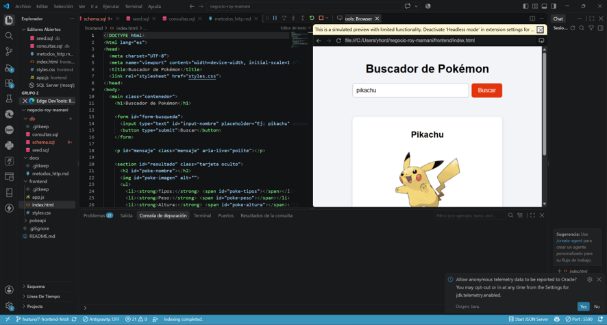
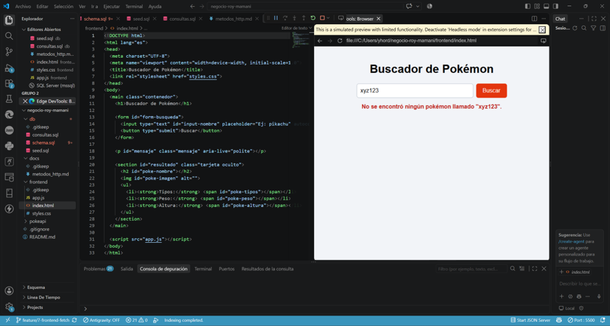

# App de búsqueda de Pokémon (PokeAPI)

Página web que consulta `https://pokeapi.co/api/v2/pokemon/{nombre}` con `fetch`.
Archivos: `frontend/index.html`, `frontend/styles.css` y `frontend/app.js`.

## Qué muestra
Nombre, imagen, tipos, peso (kg) y altura (m).
La API entrega el peso en hectogramos y la altura en decímetros, por eso se divide entre 10.

## Cómo está resuelto
- `async/await` con `try/catch`.
- Se valida `response.ok` antes de leer el JSON.
- Mientras responde se muestra "Cargando...".
- Si el pokémon no existe (404) o falla la conexión se muestra un mensaje claro.

## Cómo ejecutarla
Abrir `frontend/index.html` en el navegador (o con la extensión Live Server de VS Code).

## Capturas

**Pokémon encontrado (pikachu)**

**Error (pokémon que no existe)**

